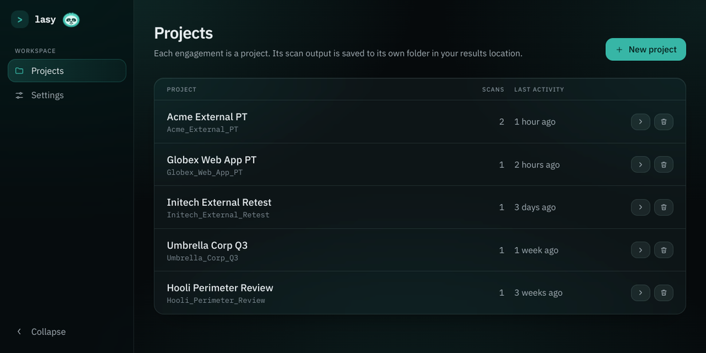
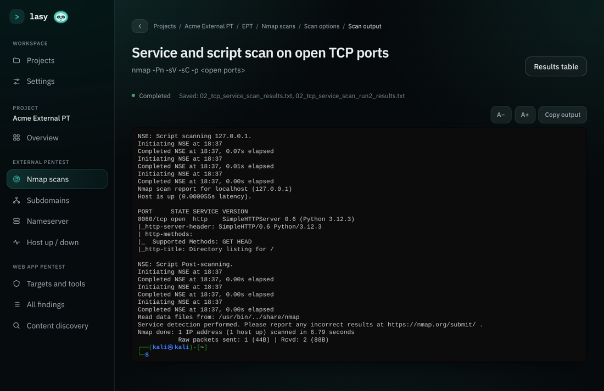
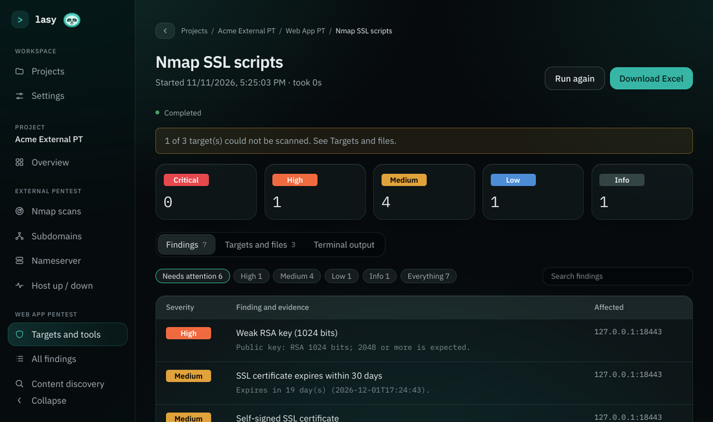

# lasy

**Lazy, smart pentest automation for WSL Kali.** lasy runs your recon and scanning workflow for you, shows each tool in a Kali-style terminal, turns the output into tables and findings, and exports Excel for your report.

> **Legal notice.** lasy automates scanning tools. Use it only on systems you own or have written permission to test. You are responsible for how you use it.



## What it does

- **External pentest:** nmap in parallel batches that can be paused and resumed (top ports, service scan, UDP, full-port), a results table that fills in live, subdomain enumeration (subfinder, knockpy, amass, assetfinder, crt.sh) with resolving and reachability checks, nameserver lookup, and host up/down.
- **Web app pentest:** Nmap SSL scripts, testssl.sh, Nikto, Nuclei, ffuf, feroxbuster and dirsearch. Run them all in order or one at a time. Findings are sorted by severity, and discovered endpoints are ranked by what to look at first.
- **A real terminal view:** every tool runs in a pseudo-terminal and is shown with the colours and prompt of a Kali WSL window, ready for report screenshots.
- **Excel exports** for tables and findings, downloaded straight to your Windows Downloads folder.
- **Projects:** each engagement gets its own folder on your Windows drive, with one subfolder per tool. Nothing is overwritten.
- **Settings for every tool:** options and extra arguments per tool, with the exact command shown as you change them.





## Requirements

- Windows 10 or 11 with WSL2 and Kali Linux
- Internet access inside Kali for the one-time install
- A folder on your Windows drive for results, for example `/mnt/c/Users/you/lasy`

## Install

Keep the folder in your Linux home (`~/lasy`), not under `/mnt/c`.

```bash
git clone https://github.com/YOUR-USERNAME/lasy.git ~/lasy
cd ~/lasy
bash scripts/install.sh
```

The installer asks for your sudo password once. It installs only the tools you don't already have, lets nmap scan without sudo, and adds the `lasy` command. Then open a new terminal and run:

```bash
lasy doctor    # checks that everything is ready
lasy           # starts lasy and opens it in your Windows browser
```

On first launch, choose your results folder. You can change it later in Settings.

## Update

```bash
cd ~/lasy
git pull
lasy restart
```

Then hard-refresh the browser with Ctrl+Shift+R.

## Commands

| Command | What it does |
| --- | --- |
| `lasy` | Starts lasy (if needed) and opens it in your browser |
| `lasy stop` / `lasy restart` | Stops or restarts the backend |
| `lasy status` | Shows whether lasy is running |
| `lasy logs` | Follows the backend log |
| `lasy doctor` | Checks tools, permissions, wordlists and your results folder |

## Where your data lives

Only tool output goes to your Windows results folder. Everything else stays on the Linux side, so the project folder holds no client data.

| What | Where |
| --- | --- |
| Tool output, Excel exports | Your results folder, one folder per project |
| Database, terminal history, logs | `~/.local/share/lasy/` |

## How it works

A Python backend (FastAPI, SQLite) runs inside Kali and starts each tool in a pseudo-terminal. A React app in your Windows browser shows the live output with xterm.js and reads results from the structured files the tools write. The whole thing is one local process on `127.0.0.1:8847`; there is no login because it is single-user and local only.

## More

See the [user guide](docs/GUIDE.md) for how each part works, the settings, pause and resume, and troubleshooting.

## License

MIT. See [LICENSE](LICENSE).
